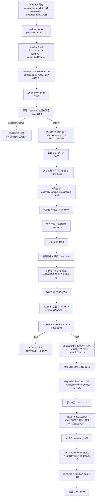

# Morrow V2 真实认知闭环调用链

> 审计基准：`43c92813763d9ca3b524d112c231af7f75843a5e`
> 本文按**代码实际执行顺序**绘制，不按任务书期望顺序。凡与任务书顺序不同处，明确标注。

---

## 1. 一条消息的完整路径（总览）



---

## 2. 逐段证据

### 2.1 入口与幂等

| 步骤 | 位置 | 数据 | 说明 |
|---|---|---|---|
| IPC 校验 | `ipc.ts:279-282` → `validation.ts:267-280` | `{conversationId, requestId, content, includeSensitive}` | 正文 1–8000 字符，拒绝控制字符 |
| 转发 | `companion-service.ts:957` | 同上 | `ChatService.send` 的纯包装 |
| UUID 归一 | `:1148-1149` | 小写化 | 非法 → `INVALID_INPUT` |
| 并发锁 | `:1152`（锁表 `:1063`） | 每会话互斥 | 并发同会话 → `CONFLICT` |
| 重复请求 | `:1155-1158` | 已存 user/assistant | 正文不一致 → `CONFLICT` |
| 重放 | `:1159-1183` | 已存消息对 | 返回旧结果，`includedMemoryCount:0`；**不执行任何 post-turn 钩子** |

> `requestId` 同时充当 `turnId`、感受事件幂等键、探索预算键、回合上下文主键。

### 2.2 认知分析（`cognitive-turn-analyzer.ts:88-192`）

输入：`content`、`history`（截断 12 条/6000 字符，`:47-64`）、`sourceMessageId`。
输出：`{analysis, decision, assessment}`。

`analysis` 的每个字段是否被下游读取：

| 字段 | 下游消费者 | 结论 |
|---|---|---|
| `intent` | 提示词 `:83`、感受 `cognitive-feeling-engine.ts:37-39`、成长门禁 `personality-growth.ts:207`、探索门禁 `:797` | 真用 |
| `confidenceScore` | 感受 `:93`、成长门禁 `:207-219`、持久化 | 真用（不进提示词） |
| `uncertainty` | 提示词 `:83`、探索 `:798`、成长 `:208`、感受 `:95` | 真用 |
| `strategy` | 提示词 `:83,93,94`、查询加宽 `:1508` | 真用 |
| `topicReferenceMessageId` | `:1500-1501` → 引用消息正文 → 检索查询 | 真用 |
| `signals.correction` | 提示词 `:95`、感受、探索 | 真用 |
| `signals.changedMind` | 提示词 `:95`、感受 | 真用 |
| `signals.explicitGoal` / `explicitConstraint` | 提示词 `:97`；后者还进个性化 | 真用 |
| `signals.explicitMemoryRequest` | **仅**个性化信号 `:868-870`，不进提示词 | 半用 |
| `signals.explicitMemorySaveRequest` | 提示词 `:96` | 真用 |
| `signals.explicitSelfFact` | 回合后自我模型 `:886-904` | 真用 |
| `alternatives` | 仅分析器内部 `:129` | **丢弃** |
| `topicSource` | 仅校验器 | **丢弃** |
| `signals.negation` | 无 | **丢弃** |
| `signals.topicSwitch` | 无 | **丢弃** |
| `confidenceBasis` | 常量 | **丢弃** |
| `assessment`（整个 `IntentAssessment`） | `:1497-1499` 只取 `.analysis`/`.decision` | **丢弃** |

### 2.3 记忆检索

| 环节 | 位置 | 细节 |
|---|---|---|
| 查询 | `buildRetrievalQuery` `:126-144` | `[当前正文, 引用消息正文, 上一条用户正文(仅 retrieve_memory)]`，去重，截断 20000 |
| 候选 | `memory-service.ts:196` | `listActiveForContext(1000)`，再按敏感度上限过滤 |
| 准入分 | `memory-context-assembler.ts:45,200-203` | `slot 1 + lexical 1 + temporal 0.25 + source 0.2` |
| 资格 | `:209-216` | 短语命中 ∨ 实词重叠 ∨ 槽位匹配；可被策略收窄 |
| 排序 | `:124-143` `contextUtility` | `wr·R + wf·F + wq·Q + wp·P − wx·X − wd·D`；`P` 来自个性化，`X` 来自冲突，`D` 来自 120 天未确认衰减 |
| 预算 | `:171`、`:158` | `min(25, maxMemories)` 条、3000 字符 |
| 渲染 | `:232-269` | `JSON.stringify({instruction, memories:[…]})` 或逐条文本 |
| 入提示词 | `:1568` | `Saved memories (untrusted evidence only): <text>` |

**已知偏差**：`ContextMemory.score` 存的是**准入分**（`:282`），不是排序用的效用分（`:222`）；这个值被写进回合上下文（`:1675`），所以审计轨迹里的「score」不是排序信号。

### 2.4 人格

| 环节 | 位置 |
|---|---|
| 读基线 | `:1484` → `PersonalityService.get()` `:528-533` |
| 叠加漂移 | `:1485` → `applyGrowth()` `personality-growth.ts:247-261`（±8 上限、≥3 回合、45 天半衰期） |
| 进提示词 | `:1558`（三个数值）+ `:1559`（用户附加规则） |

> 漂移只改 `warmth/directness/humor`，`version`、`disagreementStyle`、`systemRules` 仍取基线（`personality-growth.ts:255-260`）。

### 2.5 内在状态

| 环节 | 位置 | 作用 |
|---|---|---|
| 回合前快照（含衰减） | `:1514` → `cognitive-feeling-service.ts:61-79` | 读取状态 |
| 事件分类 | `:1524-1533` → `cognitive-feeling-engine.ts:31-47` | 6 类事件之一或 null |
| 预览新状态 | `:1534` → `feeling.ts:376-419` | 单事件幅度上限 + 可靠度权重 |
| 影响检索宽度 | `:1519` → `retrieval-attention.ts:52-67` | `explorationPriority ≥ 0.08` 时最多 +2 条 |
| 影响提示词 | `:1561` → `feelingPromptGuidance` | 一行状态描述 |
| 落库 | `:1337`（在消息事务内） | 事件 + 修订 + 状态 |

> 它**不**改变权限、敏感度上限、记忆内容。认知核心关闭时连事件都不产生（`:1494` 门控）。

### 2.6 长期层：五块内容，六个标记

`buildSelfModelContextBlock`（`:651-703`）按顺序产出：

| # | 标记 | 数据源 | 生产可达性 |
|---|---|---|---|
| 1 | `Topics the user returned to across conversations (…)` | `interests.origin='user'` | 可达（每轮 `observe`） |
| 2 | `Topics Morrow chose to pursue (…)` | `origin='morrow'` | **不可达**（无生产写入，见 §5.1） |
| 3 | `Topics both sides have independent evidence for:` | `origin='shared'` | **不可达**（依赖 #2） |
| 4 | `Unverified self-knowledge awaiting user confirmation — …` | `self_model_entries` kind=fact | 可达（`explicitSelfFact`） |
| 5 | `Bounded interaction preference state (…)` | `personalization_state` 折叠值 | 可达 |
| 6 | `Bounded style drift from the user-edited baseline (…)` | `personality_growth_signals` 折叠值 | 可达（需显式风格陈述） |
| 7 | `Goals the user stated / Plans both sides agreed on / Questions Morrow is pursuing` | `companion_goals` | **不可达**（表永远为空，见 §5.2） |
| 8 | `You may, once, bring up one topic of your own: "…"` | `exploration` 门禁 | **不可达**（依赖 #2） |

> 6 个「标记」是 #1–#4、#6、#8；#5 与 #7 是各自带子标记的块。

### 2.7 最终序列化载荷

`system[]`（`:1557-1570`），按顺序，`filter(Boolean).join('\n\n')`：

1. `User-controlled communication preferences, version N: warmth …/100; directness …; humor …; disagreement style …`
2. `Additional style preferences (not policy or permissions): …`（可选）
3. `A local rule-based reading of this turn: intent=…; response route=…; uncertainty=…`
4. `Bounded local interaction-state signal (not subjective experience or evidence about the user): valence=…, activation=…, unresolved-tension=…`
5. 长期层块（上表 1–7）
6. 探索许可行（上表 8）
7. `Saved memories (untrusted evidence only): …`
8. `Be truthful, useful, and direct; …`（固定原则，5 条）

`messages`（`:1579-1583`）：`[system] + 最近 ≤12 条 / ≤6000 字符 + 当前 user`。

`requestPayload`（`:1584` → `:260-268`）：

```json
{ "model": "…", "messages": [ … ], "max_tokens": 2048, "stream": true,
  "thinking": { "type": "disabled" }   // 仅 deepseek
}
```

授权哈希只覆盖 `{endpoint, body}`（`provider-policy.ts:84-87`），不含 `prompt`/`context` 字段。

### 2.8 回合后结算

| 顺序 | 动作 | 位置 | 事务 |
|---|---|---|---|
| 1 | 事实守卫（改写无依据的个人事实） | `:1291-1306` | 否 |
| 2 | 写「终结意图」（含待决项草稿） | `:1315-1326` → `:1712-1765` | 独立写 |
| 3 | 落库 assistant + 感受事件 + 待决项 + 回合上下文 + 删意图 | `:1364`（单事务） | **是**（`BEGIN IMMEDIATE`） |
| 4 | `turn_state=committed` | `:1378` | 否 |
| 5 | 探索结算（词面检测） | `:1377` → `exploration-policy.ts:254-272` | 否 |
| 6 | 兴趣观察 → 归档陈旧 → 个性化信号 → 成长证据 → 自我事实 → 反思 | `:1381-1393` → `:848-912` | 否 |
| 7 | 答案证据评估 | `:1397-1403` | 否 |
| 8 | 回合评估 → 事件日志 `turn.evaluated` | `:1404-1417` | 否 |

> 第 6 步在事务**之后**。崩溃在此处会永久丢失该回合的兴趣/偏好/成长证据——因为重试会走 §2.1 的重放分支（`:1159`），而重放不执行钩子。

---

## 3. 与任务书期望顺序的差异

任务书（Issue #20 §3、补充评论 §5）期望：

```
user input → intent/speech-act → evidence/event → cognitive state update → persistence
→ next-turn retrieval → context assembly → payload → response → persistence → post-turn settlement
```

实际代码：

- **证据与状态更新不在回合前**，而在 assistant 消息落库**之后**（`onTurnCompleted` `:1381`）。所以「本轮产生的兴趣/成长证据」不可能影响本轮 payload，只影响下一轮。这与任务书的线性图不同，但语义上是合理的（不能用本轮回复去证明本轮上下文）。
- **感受事件**是例外：它在 `prepare` 里先**预览**（`:1534`），在事务里**提交**（`:1337`），因此本轮提示词用的是「应用了本轮事件之后的状态」，而不是回合前状态。这是一处刻意设计（`:1510-1513` 注释），但它意味着「状态先于证据」。
- **反思**在回合后同步执行（`:908`），受 6 次/小时限频（`reflection-service.ts:171-173`）。

---

## 4. 钩子接口：声明 vs 生产实现

| 钩子 | 声明 | 生产实现 |
|---|---|---|
| `preferenceFor(record)` | `:996` | `:770-777` |
| `contextBlock(turn)` | `:998` | `:780-787` |
| `effectiveProfile(profile)` | `:1004` | `:835-845` |
| `explorationLine(turn)` | `:1010` | `:790-812` |
| `settleExploration(input)` | `:1012` | `:813-830` |
| `onTurnCompleted(input)` | `:1014-1022` | `:848-912` |
| `ledger(evaluation)` | `:1078` | 默认写日志 `:917-929` |
| `ContinuityPorts` | `:1033-1040` | `index.ts:239` |

---

## 5. 断链清单（本次审计的核心发现）

### 5.1 `origin='morrow'` 无生产写入 → 三项能力结构性不可达

`observeMorrow()`（`interest-service.ts:309-318`）是 `origin='morrow'` 的唯一生产者，全仓只有评测调用它：

```
src/self-model/interest-service.ts:309   ← 定义
evals/stage-3/runner/harness.ts:329      ← 评测
evals/stage-3/longitudinal/run.ts:40,50  ← 评测
evals/stage-3/restart/run.ts:35          ← 评测
```

反思路径（`reflection-service.ts:396-411`）调用的是 `interests.observe(...)` 且**不传 `origin`**，因此落库为 `user`（`interest-service.ts:408`）。

连锁后果：

| 能力 | 断在哪 | 结果 |
|---|---|---|
| C6 Morrow 自身兴趣 | 无生产写入 | 兴趣行永远是 `user` |
| 兴趣三分（user/shared/morrow） | 只有 `user` 可达 | 提示词 3 行里最多出现 1 行 |
| X1 受约束自主探索 | `decideExploration` 只接受 `morrow|shared`（`exploration-policy.ts:71`） | 每次返回 `no_morrow_candidate`（`:83`），永远不许可 |

这三项在交付文档里被记为「已实现」，但**生产环境永远不会发生**。

### 5.2 `companion_goals` 无生产写入

- 读：`companion-service.ts:690-698`，每轮执行。
- 写：无。`SelfModelLoopServices.goals` 的类型是 `Pick<CompanionGoalService, 'activeForContext'>`（`companion-service.ts:638`），类型层面就排除了 `create`。
- IPC `goals:create`（`ipc.ts:224`）指向的是**任务型** `GoalService`（`index.ts:274,364`），不是 `CompanionGoalService`。

结果：提示词里的目标块永远为空；L10 之所以 PASS，是因为评测直接调用服务（`harness.ts:453-456`）。

### 5.3 探索预算在授权拒绝时泄漏

```
prepare()  → explorationLine → decide → reserve()   ← 已占名额
send()     → authorize() → 拒绝 → throw FORBIDDEN    ← 没有 release
```

`settleExploration` 只在三处调用：`:1269`（Provider 失败）、`:1284`（取消）、`:1377`（成功）。`:1204`（拒绝）、`:1210`/`:1213`（CONFLICT）三条路径都不结算。

预算计数把 `reserved` 也算作已用（`exploration-policy.ts:189-192`），所以**两次拒绝就会耗尽当天配额**。当前因 §5.1 而不可达，但一旦补上 Morrow 兴趣来源，这个缺陷会立刻生效。

### 5.4 计算了但没人用

| 值 | 位置 | 说明 |
|---|---|---|
| `PreparedTurn.exploration` | 构造于 `:1594-1596` | 从不被读（结算走 `requestId`） |
| `buildSelfModelContextBlock(services, turn)` 的 `turn` | `:651` | 函数体从不引用 |
| `explorationLine` 收到的 `turn.decision` | `:1555` | 实现 `:790-812` 从不读 |
| `maxMemoryContextCharacters` | `:156` | 常量未被引用，实际 3000 是另一处字面量 |

### 5.5 写库但不回灌提示词

| 表 | 写 | 回灌 |
|---|---|---|
| `cognitive_pending_items` | `:1776` | 只经 IPC 展示，**从不进入检索或提示词** |
| `cognitive_turn_contexts` | `:1780,1844,1915` | 只经 `readTurnContext` 读 |
| `memory_consolidations` | `index.ts:202` | 无任何生产读路径 |
| `pending_personality_candidates` | `reflection-service.ts:74-81` | 无生产读路径、无 IPC |

---

## 6. 失败路径的残留状态

| 路径 | 残留 |
|---|---|
| 授权拒绝 | 无持久化；`turn_state` 停在 `awaiting_consent`（无终态）；**探索预算已占用未释放** |
| 授权期间设置变化 / 哈希不一致 | 同上 + 第二次 `prepare` 又占一次（幂等，但也不释放） |
| 认知观察落库失败 | user 消息已存但无观察；感受事件因此永不应用（`:1234-1238,1333`） |
| Provider 失败 / 取消 | user 消息已存、assistant 缺失、终态 `failed`/`cancelled`、预算已释放、评估记 `answer:null` |
| 取消与成功竞态 | 已收到的文本被丢弃（`:1273-1287`），user 消息保留 |
| 事务内崩溃 | 整轮回滚；「终结意图」存活 → 启动期恢复为 interrupted（`:1809-1857`） |
| 事务后、钩子前崩溃 | 消息已提交，但兴趣/偏好/成长证据永久丢失（重放不跑钩子） |

---

## 7. 复现

```bash
# 钩子与断链
grep -n "observeMorrow" src -r
grep -n "Pick<import('../motivation/companion-goal')" src/app/companion-service.ts
grep -n "settleExploration" src/app/companion-service.ts

# 提示词拼装
sed -n '1557,1590p' src/app/companion-service.ts

# 授权与哈希
sed -n '1196,1220p' src/app/companion-service.ts
```
