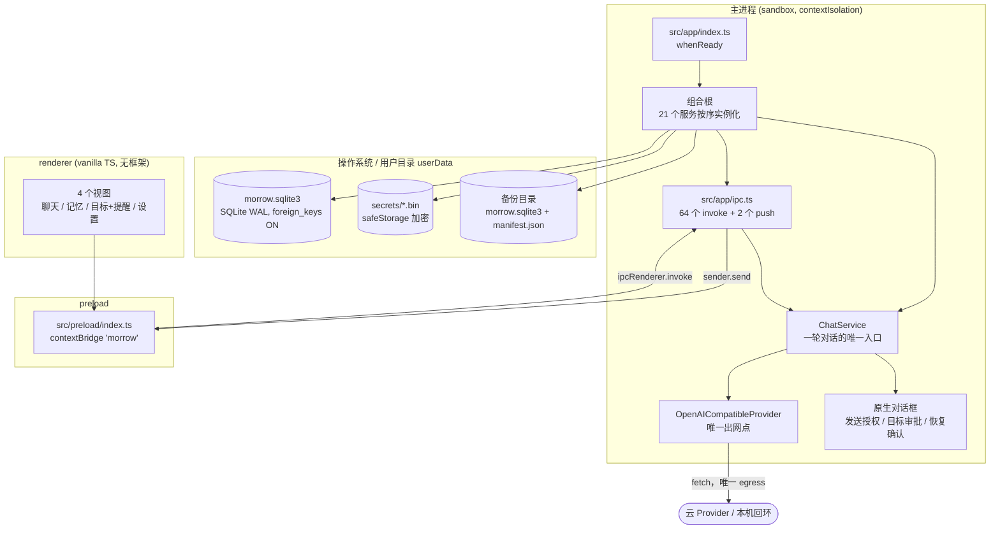
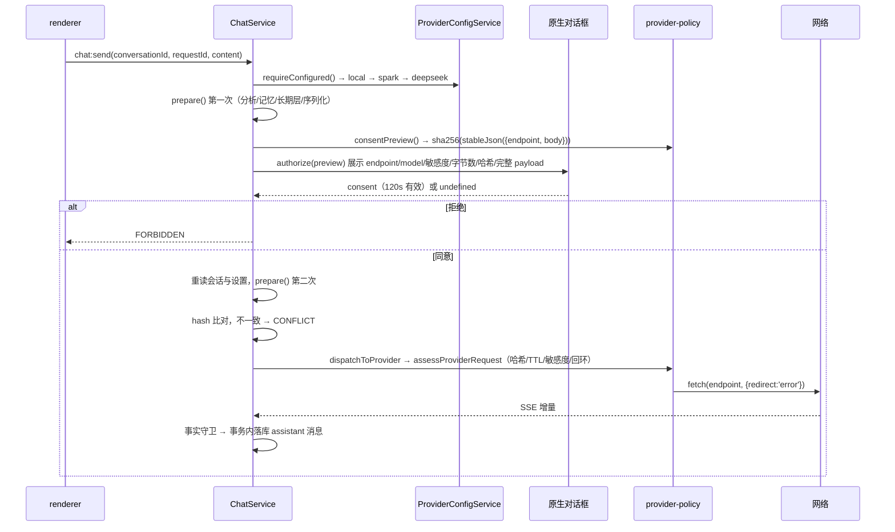

# Morrow V2 真实运行时架构

> 审计基准：`43c92813763d9ca3b524d112c231af7f75843a5e`（分支 `feat/stage-3-long-term-companion`，PR #19）
> 本文只描述**代码里真实存在**的结构。每条连线后面都有 `文件:行号`。没有源码依据的推测一律标注「未证实」或不写。

---

## 0. 这份地图是怎么被证明的

本地工作副本没有 `.git`（源码经 GitHub tarball 取得）。因此「我审的是不是那个提交」不能靠声明，必须可计算：

| 校验 | 方法 | 结果 |
|---|---|---|
| 文件级一致性 | 对远端 tree 的每个 blob 重算 `sha1("blob <len>\0" + content)`，与 GitHub 返回的 blob sha 比对 | 远端 496 个 blob：**473 完全一致**，1 个仅行尾差异（`scripts/windows-alpha-install-acceptance.ps1` 本地 CRLF、远端 LF，按 LF 归一后 sha 相同：`ce8845ab…`），22 个本地缺失（均为我复跑评测时删除的旧结果文件，远端仍在） |
| 分支 HEAD | `gh api repos/.../branches/feat/stage-3-long-term-companion` | `43c9281`，2026-10-30T14:21:56Z，与任务书给定值一致 |
| 提交链 | `compare/8467079...43c9281` | ahead 12，73 文件变更 |

**结论：本审计阅读的源码与提交 `43c9281` 在全部源文件上逐字节一致。** 唯一不一致的是行尾，且已证明归一后一致。

---

## 1. 进程边界



依据：

| 节点 | 证据 |
|---|---|
| 三个构建目标 | `electron.vite.config.ts:39-62`（main=`src/app/index.ts`，preload=`src/preload/index.ts`，renderer=`src/renderer/index.html`） |
| 沙箱与隔离 | `src/security/security.ts:13-20`（`sandbox:true, contextIsolation:true, nodeIntegration:false, webSecurity:true`）；`src/app/index.ts:62` `app.enableSandbox()` |
| 唯一出网点 | `src/providers/openai-compatible.ts:269` `this.fetcher(...)`，默认 `fetch`（`:153`）；`src` 内无第二处 `fetch`/`node:http`/`WebSocket` 运行时调用 |
| 数据库 | `src/app/index.ts:188-189`；`src/persistence/database.ts:98-103`（WAL、`foreign_keys=ON`、`secure_delete=ON`、`busy_timeout=5000`） |
| 凭据 | `src/security/secrets.ts:51-70,101-103`（`safeStorage.encryptString` → `userData/secrets/<id>.bin`，目录 0700、文件 0600、临时文件+rename） |
| 备份 | `src/persistence/backup-service.ts:203-216`（`VACUUM INTO`） |

---

## 2. 启动顺序（真实执行序）

`src/app/index.ts`，全部在 `app.whenReady()` 内：

| # | 动作 | 行 | 失败处理 |
|---|---|---|---|
| 1 | 单实例锁 | `:65-66,182` | 未取得则退出 |
| 2 | 解析可信 renderer URL | `:184-186` → `security.ts:28-34` | 空环境变量不得变成可信 URL |
| 3 | 打开 SQLite（含迁移） | `:188-189` | 抛错 → 错误框 + 退出（`:410-421`） |
| 4 | 写 `app.started` 事件 | `:190-191` | — |
| 5 | 记忆重要度一次过：`recomputeAll → consolidate → archiveBelow(0.35,180d)` | `:195-209` | `try/catch` 吞掉，只 `console.warn`（`:207-209`） |
| 6 | 实例化 21 个服务 | `:190-308` | — |
| 7 | 恢复被中断的回合 | `:243-258` | 幂等 |
| 8 | 启动提醒调度 | `:303` | 受 `MORROW_ENABLE_LOCAL_REMINDERS==='true'` 门控（`:266`），默认关 |
| 9 | 启动期反思 | `:306-307` | 限频在服务内 |
| 10 | 注册 IPC | `:362-404` | 失败回滚已注册 handler（`register-ipc.ts:18-21`） |
| 11 | 创建窗口 | `:362-405` | 加载失败 → 错误框 + 退出（`:162-168`） |

退出：`before-quit` 依次关事件、停提醒/companion、注销 IPC、关库（`:424-439`）。

---

## 3. 组合根：21 个服务与真实注入关系

`src/app/index.ts:183-405`，按实例化顺序：

| # | 服务 | 行 | 构造参数 | 被谁消费 |
|---|---|---|---|---|
| 1 | `SqliteDatabase` | 188 | `userData/morrow.sqlite3` | 全部 |
| 2 | `EventLogService` | 190 | `database` | 记忆/兴趣/自我模型/反思/感受/回合评估 |
| 3 | `MemoryImportanceService` | 195 | `database` | `MemoryService` 的 importance 端口；启动期一次过 |
| 4 | `MemoryService` | 196 | `repo, undefined, undefined, eventLog, {importance}` | `ChatService`、IPC、`GoalService` |
| 5 | `ConversationService` | 210 | `repo` | `ChatService`、IPC |
| 6 | `InterestService` | 211 | `repo, eventLog` | 长期层上下文块、探索门禁 |
| 7 | `SelfModelService` | 212 | `repo, eventLog` | 长期层上下文块、反思 |
| 8 | `PersonalizationService` | 213 | `database` | 上下文块、检索偏好项 `P` |
| 9 | `PersonalityGrowthService` | 217 | `database` | `effectiveProfile`、上下文块 |
| 10 | `ExplorationService` | 218 | `database` | `explorationLine` / `settleExploration` |
| 11 | `CompanionGoalService` | 221 | `database` | 上下文块（**只读，见 §7.2**） |
| 12 | `ReflectionService` | 222-226 | `repo, {memories,interests,selfModel,events}, eventLog` | 回合后 / 启动期 |
| 13 | `PendingCognitionService` | 229 | `repo` | 连续性端口 |
| 14 | `SqliteTurnContextRepository` | 230 | `database` | 连续性端口 |
| 15 | `SqliteTurnFinalizationRepository` | 231 | `database` | 连续性端口 |
| 16 | `CompanionService` | 232-240 | 见下 | IPC |
| 17 | `SqliteGoalRepository` | 260 | `database` | 任务型 `GoalService` |
| 18 | `ReminderService` | 261-272 | repo, goalRepo, 通知端口, 开关 | 任务型 `GoalService` |
| 19 | `GoalService` | 274-301 | goalRepo, memories, {reminderLifecycle, approvalGate} | IPC `goals*` |
| 20 | `BackupService` | 308 | `database, databasePath` | IPC `backup*` |
| 21 | `registerIpcHandlers` | 362-404 | 动作包 | 全部 IPC |

`CompanionService` 的注入（`index.ts:232-240`）：

| key | 值 |
|---|---|
| `database` / `memories` / `conversations` | 上述实例 |
| `secrets` | `SafeStorageSecretStore(userData)`（`:236`） |
| `authorize` | `requestProviderConsent`（`:78-136`，真实原生对话框） |
| `selfModelLoop` | `{events, interests, selfModel, reflection, personalization, growth, exploration, goals}`（`:238`） |
| `continuity` | `{contexts, pending, finalizations, states}`（`:239`） |

内部再实例化（`companion-service.ts:744-747, 932-933`）：`ProviderConfigService`、`PersonalityService`、`CognitiveSettingsService`、`CognitiveFeelingService`、`ChatService`、`MemorySuggestionService`。

---

## 4. IPC 边界

| 事实 | 数值 / 证据 |
|---|---|
| 声明通道 | 66（`src/shared/contracts.ts:26-93`） |
| invoke handler | 64（`src/app/ipc.ts:214-287`） |
| push 通道 | 2：`morrow:chat:delta`（`ipc.ts:281`）、`morrow:reminders:changed`（`index.ts:268-270`） |
| 统一守卫 | 发送者必须是主框架且 URL 可信，否则 `FORBIDDEN`（`ipc.ts:147-151,198`） |
| 统一返回 | `{ok:true,data}` / `{ok:false,error:{code,message}}`（`ipc.ts:191-204`） |
| 输入校验 | 每通道独立 parser（`src/shared/validation.ts`），未知异常收敛为 `INTERNAL_ERROR`（`ipc.ts:180-183`） |
| 注册原子性 | 失败时回滚已注册 handler（`register-ipc.ts:18-21`） |

**能力 → 通道映射（节选）**

| 能力 | 通道 |
|---|---|
| 发消息 | `morrow:chat:send`（授权对话框在 handler 内部） |
| 取消 | `morrow:chat:cancel` |
| 记忆 | `memory:create/list/search/history/correct/revoke/restore/delete` + `memory-suggestions:*` |
| 人格 | `personality:get/save/history/restore` |
| Provider | `provider:get/save/clear-credential/test-connection` |
| 备份 | `backup:export/preview/restore` |
| 自我模型 | `selfmodel:interests:list`、`selfmodel:entries:*`、`selfmodel:reflection:*` |
| 连续性 | `continuity:pending:*`、`continuity:turn:read` |

**没有 renderer 调用方的通道（11 个）**

`grep -rn "selfModel\|continuity" src/renderer` 无匹配。这 11 个通道在服务端完全接通（`ipc.ts:247-261` + `index.ts:370-403`），但界面上没有任何入口：

`selfmodel:interests:list`、`selfmodel:interests:set-status`、`selfmodel:entries:list`、`selfmodel:entries:correct`、`selfmodel:entries:retract`、`selfmodel:reflection:run`、`selfmodel:reflection:runs`、`selfmodel:reflection:findings`、`continuity:pending:list`、`continuity:pending:complete`、`continuity:turn:read`。

---

## 5. Provider 路由与授权



| 环节 | 证据 |
|---|---|
| 选择顺序 local → spark → deepseek | `companion-service.ts:470-487`；`assertUsable` `:489-493` |
| 远端白名单（endpoint 与 model 双重精确匹配） | `providers/provider-registry.ts:19-34,41-44` |
| 本机端点必须自证回环（不做 DNS 信任） | `security/url-gate.ts:6-29`；五处强制（`validation.ts:186-188`、`companion-service.ts:377,492`、`provider-policy.ts:102-104`、`openai-compatible.ts:172,240`） |
| 哈希 | `provider-policy.ts:77-87`（`stableJson({endpoint, body})` → SHA-256），`timingSafeEqual` 比较 `:142-147` |
| 发送前最后一刻再校验 | `provider-policy.ts:125-140`（校验紧贴 `provider.generate`，无 TOCTOU 窗口） |
| 授权有效期 | 主进程铸造 120s（`index.ts:127-135`）；策略层另限 ≤5 分钟（`provider-policy.ts:109-118`） |
| 序列化体 | `{model, messages, max_tokens, stream, thinking?}`（`companion-service.ts:260-268`）；聊天 `stream:true`、`max_tokens:2048`、deepseek 带 `thinking:{type:'disabled'}`（`:1584`） |
| 重试 | 仅 `RATE_LIMIT|TIMEOUT|NETWORK`，最多 3 次，总预算 90s，已吐增量则不重试（`openai-compatible.ts:32-33,203-232`） |

---

## 6. 安全与隐私边界

| 层 | 机制 | 证据 |
|---|---|---|
| 窗口 | 沙箱、隔离、禁止新窗口、禁止 webview、拒绝所有权限请求、导航白名单 | `security.ts:5-22,36-52`；`index.ts:149-157` |
| IPC | 发送者来源校验 + 严格 payload parser | `ipc.ts:17-32,147-151` |
| 凭据 | 仅 safeStorage 加密文件；DB 无密钥列 | `secrets.ts:51-103`；`migrations.ts:233-241,629-643` |
| 日志 | 键名脱敏（apikey/authorization/token/secret/password/credential/payload/prompt/content/body/context），字符串截断 500 | `observability/logger.ts:7-10,25` |
| 错误 | 只回静态中文文案，不带路径/密文 | `ipc.ts:153-177`；`ipc.test.ts:300-320` |
| 备份 | 只含 DB + manifest，不含 secrets | `backup-service.ts:203-216`；`backup-service.test.ts:207-220` |
| 删除 | `secure_delete=ON` + 触发器级联 | `database.ts:98-103`；迁移 19/21/22/23/24/25/29/30 |

---

## 7. 未接线 / 死代码（本次审计的硬发现）

### 7.1 类存在但运行时从不实例化

| 项 | 证据 | 影响 |
|---|---|---|
| `RequestLedger` | 仅 `scripts/cognitive-evidence-experiment.ts:43`、`scripts/cognitive-phase2-benchmark.ts:51` | 基准脚本专用，不进应用图 |
| `MemorySecretStore` | 仅测试构造（`security/secrets.test.ts`） | 测试替身 |
| `parseProviderGetRequest` | `validation.ts:201-207` 从未被 import；`ipc.ts:263` 用 `emptyRequest` | 死校验器 |

### 7.2 有读路径但没有写路径（结构性死块）

| 项 | 读 | 写 | 结论 |
|---|---|---|---|
| `companion_goals` | `companion-service.ts:690-698` 每轮读 | **无生产写入**。`SelfModelLoopServices.goals` 被声明为 `Pick<CompanionGoalService,'activeForContext'>`（`companion-service.ts:638`），类型上就排除了 `create` | 目标块永远为空 |
| `memory_consolidations` | 仅 `memory-importance.test.ts:148,158` | `index.ts:202` 每次启动写 | 写了没人读 |

### 7.3 有写路径但没有读路径

| 项 | 写 | 读 |
|---|---|---|
| `pending_personality_candidates` | `reflection-service.ts:74-81` | 仅 `:167-169`，唯一调用方是测试；无 IPC |
| `personality_growth_events` | `personality-growth.ts:456-459` | `history()` `:406-412`，无生产调用方、无 IPC |
| `memory_importance.score` | `memory-importance.ts:146-154` | 只有 `archiveBelow` 的 JOIN（`:181-185`）；**检索排序不读它** |
| `interest_evidence.match_score/match_reason` | `interest-service.ts:148-154` | 仅测试用的 `evidenceTrail` |

### 7.4 只在测试/评测中可达的分支

| 分支 | 位置 | 唯一调用方 |
|---|---|---|
| `guidanceVariant !== 'v2'` | `companion-service.ts:87-92` | `scripts/cognitive-evidence-experiment.ts:94` |
| `evidencePresentation === 'entries'` | `memory-context-assembler.ts:254-269` | 同上 `:95` |
| `useContextUtility: false` | `memory-context-assembler.ts:217-224` | `evals/stage-2/ablation/run.ts:87` |
| `confidenceOverrides` | `cognitive-turn-analyzer.ts:92-96` | 评测工具 |
| `observeMorrow()` | `interest-service.ts:309-318` | **只有 evals**（`harness.ts:329`、`longitudinal/run.ts:40,50`、`restart/run.ts:35`） |

### 7.5 前端缺口

| 缺口 | 证据 |
|---|---|
| 无自我模型 / 兴趣 / 反思 / 待决项界面 | `grep -rn "selfModel\|interests\|reflection\|pendingItems" src/renderer` 无匹配 |
| 无人格漂移界面，`rollback()` 不可达 | `grep -rn "growth" src/app/ipc.ts src/preload/index.ts src/renderer/src` 无匹配 |
| 归档记忆不可见、不可恢复 | `archivedAt` 不出现在 `src/renderer`、`src/preload`、`shared/companion.ts`；`restore()` 无 IPC |
| 目标（陪伴型）无 UI | 无 IPC 通道 |
| Spark Provider 无 UI | `grep -rn "spark" src/renderer` 无匹配 |

---

## 8. 桌面 / 安装

| 项 | 状态 | 证据 |
|---|---|---|
| 托盘 / 全局快捷键 / 开机自启 / 菜单 / 自动更新 | **NOT FOUND** | `src` 内无 `Tray`/`globalShortcut`/`setLoginItemSettings`/`Menu`/`autoUpdater`；`package.json` 无 `electron-updater` |
| 系统通知 | 存在但默认关 | `motivation/reminder-notification.ts:4-21`；`index.ts:266` 门控 |
| 原生对话框 | 存在 | 授权 `index.ts:115`、目标审批 `:279`、恢复确认 `:333`、错误框 `:165,416` |
| 目录选择 / 恢复后重启 | 存在 | `index.ts:54-60,311,316`；`:47-52` |
| electron-builder | NSIS x64，`oneClick:false`，`perMachine:false`，可改安装目录，卸载保留数据 | `package.json:45-73` |
| 代码签名 / 发布 | **NOT FOUND** | 无 `certificateFile`/`win.sign`；脚本固定 `--publish never`（`package.json:20`） |
| 产物 | **不存在** | 无 `release/`、无 `dist/`、无安装包 |

---

## 9. 与文档声称的差异（仅列架构层）

| 文档说法 | 实际 |
|---|---|
| README / `system-overview.md` 列出 `src/personality/` 目录 | **不存在**。人格在 `src/app/companion-service.ts:523-623`（`PersonalityService`） |
| `docs/architecture/stage-3-cognitive-runtime.md` 引用 `companion-service.ts:876`、`:1004`、`:1397`、`:1464-1476` | 实际：`onTurnCompleted` 在 `:848`，`sendChat` 在 `:957`，`ChatService.send` 在 `:1147`，`prepare` 在 `:1470`。引用普遍偏移 3–140 行 |
| `docs/reports/stage-3-evidence-index.md` 引用 `:928`、`:1397`、`:62` | 实际 `:957`、`:1147`、`:65` |
| `package.json` version | `1.0.0`，而项目对外称 V2 |

> 行号漂移本身不是缺陷，但它说明这些文档是在代码变动前写的、之后没有复核——这正是本次治理重置要解决的问题。

---

## 10. 复现方式

```bash
# 结构核对（任选）
grep -n "input:" electron.vite.config.ts
grep -n "new .*Service(" src/app/index.ts
grep -rn "ipcMain.handle" src/app/ipc.ts | wc -l
grep -rn "fetch(" src --include=*.ts | grep -v test

# 行为门槛（本次实测，见证据索引）
npx tsc --noEmit
npx vitest run
npx electron-vite build
```
