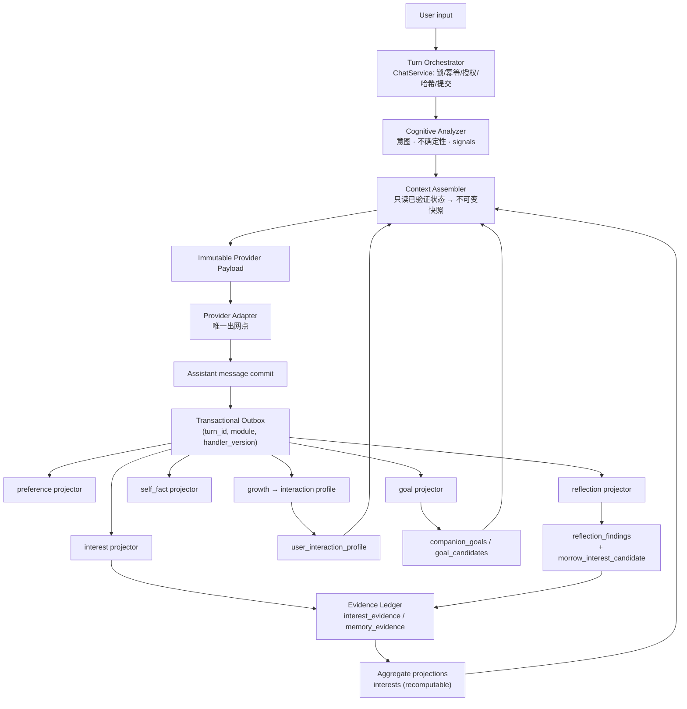
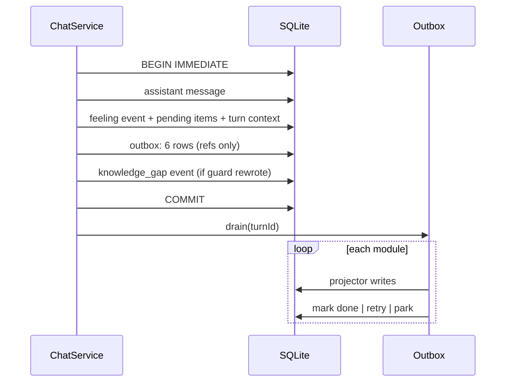

# Stage 3 目标架构 v2

> 基准：`43c92813763d9ca3b524d112c231af7f75843a5e`
> 本文描述**修复后的目标形态**，并逐项标注哪些已落地、哪些未落地。未落地的必须写明，不得让图看起来比代码更完整。

---

## 1. 为什么需要重画

修复前的形态是「CompanionService 直接串联所有认知算法」：

```
send() → prepare() → 分析 → 检索 → 提示词 → Provider → 落库 → onTurnCompleted() 串行做 5 件事
```

三个问题：

1. `onTurnCompleted` 在事务之后、单个 try/catch 里，一个模块失败会带走其余模块，进程崩溃则永久丢失该回合证据；
2. 每个模块直接写自己的聚合表，聚合行被当成事实，而事实（证据）在另一张表里，两边可以不一致；
3. 「用户希望我怎么说」与「Morrow 是谁」共用一组字段，于是每一次「说话直接点」都被记成一次人格变化。

---

## 2. 目标分层



### 2.1 各模块职责（与代码对应）

| 模块 | 职责 | 不做什么 | 代码 |
|---|---|---|---|
| Turn Orchestrator | 锁、幂等、授权、payload 哈希、事务提交 | 不承载任何认知算法 | `app/companion-service.ts` `ChatService` |
| Cognitive Analyzer | 输出结构化 reading | 不写持久状态 | `cognition/cognitive-turn-analyzer.ts` |
| Context Assembler | 只读、按预算组装 | 不写、不改状态 | `memory/memory-context-assembler.ts` |
| Evidence Ledger | 记录来源、独立性、撤回 | 不决定状态 | `interest_evidence` / `memory_evidence` |
| Aggregate Projection | 从账本重算聚合 | 不作为事实源 | `InterestService.reconcile` |
| Outbox | 持久化回合后的认知义务 | 不执行具体算法 | `app/cognitive-outbox.ts` |
| Interaction Profile | 用户要求的表达方式 | 不改身份、不改价值判断 | `personalization/interaction-profile.ts` |
| Goal Engine | 用户/共同/Morrow 三类目标 | 不执行工具 | `motivation/companion-goal.ts` |
| Reflection | 产生候选，不产生事实 | 不改基线、不自我触发 | `self-model/reflection-service.ts` |
| Exploration Policy | 本轮话题选择与频率 | 不写人格、不建目标 | `self-model/exploration-policy.ts` |

---

## 3. 事务边界



**规则**：

- 消息与「认知义务」同生共死：要么都在，要么都不在；
- outbox 只存引用（turn/message/conversation id + 结构化 signals），**不存用户原文**；
- 每个模块独立结算，失败只影响自己，`(turn_id, module, handler_version)` 幂等；
- 启动期重放未完成行，普通重试也走同一条路径。

---

## 4. 数据流：从证据到 payload

| 层 | 事实源 | 投影 | 进入 payload 的形态 |
|---|---|---|---|
| 兴趣 | `interest_evidence`（含 `kind=reflection`） | `interests`（可重算，`stale_at` 标记） | 三行归属文本 |
| 记忆重要度 | `memory_evidence` + `memory_revisions` | `memory_importance` | 排序项（不单独成文） |
| 交互画像 | `user_interaction_signals` | `user_interaction_profile` | 一行「表达方式」+ 三个数值 |
| 目标 | `companion_goals` | 无（直接读） | 三行归属文本 |
| 反思 | `reflection_findings` | 无 | 不直接进入；经兴趣通道 |

---

## 5. 落地状态（诚实标注）

| 目标形态 | 状态 | 证据 |
|---|---|---|
| Outbox + 模块级幂等 | **已落地** | `cognitive-outbox.ts`；7 条单测；`index.ts` 启动重放 |
| 证据账本 + 外键 + 级联 | **已落地** | 迁移 34；`interest_evidence` FK；触发器改为「删证据 + 标 stale + 清孤儿」 |
| 聚合可重算 + stale 拒绝注入 | **已落地** | `reconcile` / `recompute` / `activeForContext` |
| 记忆证据账本 + 类型化衰减 | **已落地** | `memory_evidence`；`halfLifeDaysFor` |
| 重要度进入排序 | **已落地** | `IMPORTANCE_WEIGHT` + 对照测试（翻转分数改变顺序） |
| 交互画像与身份分离 | **已落地** | `user_interaction_profile`；`effectiveProfile` 只读它 |
| Morrow 自身兴趣生产链 | **部分** | 通道与生产者已落地（知识缺口 → 反思 → `observeMorrow`），但只覆盖「回答被事实守卫改写」这一种缺口；覆盖率有限 |
| 目标由对话创建 | **部分** | `detectFromTurn` + 显式承诺直接建、含糊意愿建候选；候选确认只有服务方法，**无 IPC/UI** |
| 探索不确定语义 | **已落地** | `uncertain` 状态；预算按 turn 键 |
| Appraisal 重构（§3 of 任务） | **未落地** | 仍是固定增量表；见风险登记 |
| 反思质量指标 | **未落地** | 只有去重与证据校验 |
| 语音 | **未落地** | 无代码 |

---

## 6. 与旧架构的对照

| 旧 | 新 | 影响 |
|---|---|---|
| `onTurnCompleted` 单 try/catch | 6 个独立 projector | 一个坏掉不再带走其余 |
| 崩溃即丢该回合证据 | outbox 持久化 + 启动重放 | 崩溃窗口可恢复 |
| 聚合表当事实 | 账本当事实，聚合可重算 | 删除/撤回后不再有幽灵计数 |
| 删消息删整条兴趣 | 删证据 + 标 stale + 清孤儿 | 其它证据仍支撑 |
| `revision - 1` 当重复次数 | `memory_evidence` 独立分组计数 | 编辑不再冒充重复 |
| 90 天统一半衰期 | 按类型 90/180/365 | 边界与身份事实不再和闲聊同速衰减 |
| 用户风格要求写进「人格成长」 | 写进 `user_interaction_profile` | 身份不再被表达偏好改写 |
| 探索 `not_raised` 吞掉不确定 | 独立 `uncertain` 状态 | 不再把「看不出」说成「没提出」 |
| 预算按 `(scope, day, turn)` | 按 `(scope, turn)` + `reservation_day` | 跨 UTC 日结算不再丢预约 |
