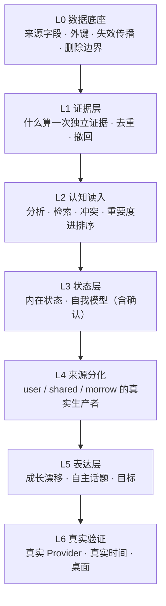

# Morrow V2 风险登记与依赖顺序

> 审计基准：`43c92813763d9ca3b524d112c231af7f75843a5e`
> 等级：**P0** = 阻断「能力真实成立」或存在数据/隐私正确性问题；**P1** = 影响可验证性或用户体验，需在下一阶段前修；**P2** = 清理项，可与功能同批处理。

---

## 1. P0（7 项）

### P0-1 `origin='morrow'` 无生产写入 → 三项能力结构性不可达

| 项 | 内容 |
|---|---|
| 证据 | `interest-service.ts:309-318`（`observeMorrow` 唯一生产者）；调用方只有 `harness.ts:329`、`longitudinal/run.ts:40,50`、`restart/run.ts:35`；反思路径 `reflection-service.ts:396-411` 不传 `origin` → 落库 `user`（`interest-service.ts:408`） |
| 影响 | C6（自身兴趣）、兴趣三分、X1（自主探索）在生产**永不发生**；提示词里 3 行兴趣最多出现 1 行；探索许可行永不出现 |
| 最小复现 | 新库跑 20 轮任意对话，`SELECT origin, COUNT(*) FROM interests GROUP BY origin` → 只有 `user` |
| 为什么是 P0 | 三项能力被记为「已实现」，但用户永远看不到。这是当前分支最大的「声称 vs 事实」差距 |

### P0-2 `companion_goals` 无生产写入 → 目标块永久为空

| 项 | 内容 |
|---|---|
| 证据 | 注入类型 `Pick<CompanionGoalService,'activeForContext'>`（`companion-service.ts:638`）在类型层排除 `create`；`goals:create` IPC 指向任务型 `GoalService`（`index.ts:274,364`） |
| 影响 | §2D 的「长期目标跨会话」在生产不存在；L10 的 PASS 是评测直调服务的结果 |
| 最小复现 | 正常使用后 `SELECT COUNT(*) FROM companion_goals` → 0 |
| 附带缺陷 | `describeGoals` 用字面 `'\n'` 连接（`companion-goal.ts:241`），一旦多类目标同时存在，提示词里会出现 `\n` 文本 |

### P0-3 人格成长的读路径零覆盖

| 项 | 内容 |
|---|---|
| 证据 | `effectiveProfile`（`:835-845`）与漂移行（`personality-growth.ts:268-276`）没有任何测试/评测断言；`grep -rn "Bounded style drift" src tests evals` 只命中生产者 |
| 影响 | 「成长改变用户可见行为」不成立为已验证事实。删掉整条读路径，L4 仍全绿 |
| 关键假阳性 | L11「重启后人格漂移连续」实测 detail `{"warmth":0,"directness":0,"humor":0}`，因为三句是裸命令句（`harness.ts:492`），门禁 abstain → **0 == 0** |
| 最小复现 | 注释掉 `:1485` 的 `effectiveProfile` 调用，重跑 `eval:stage3` → 仍 15 PASS |

### P0-4 删一条消息会删掉整条兴趣 + 证据表无外键

| 项 | 内容 |
|---|---|
| 证据 | `migrations.ts:754-759`（触发器删 `interests` 整行）；`migrations.ts:1301`（`interest_evidence.interest_id` 无 FK）；`migrations.ts:1318`（`UNIQUE(evidence_ref)` 单独成索引） |
| 影响 | ① 用户删掉一条消息，可能抹掉由另外 5 条消息支撑的兴趣；② 孤儿证据行永久残留（隐私 + 血缘双缺陷）；③ 一条消息同时支持两个主题时只能记一个 |
| 最小复现 | 用 3 条消息建立 1 条兴趣，删其中 1 条 → `SELECT COUNT(*) FROM interests` = 0，`interest_evidence` 仍有 2 行孤儿 |

### P0-5 评测存在系统性假阳性

| 项 | 内容 |
|---|---|
| 证据 | 至少 16 条断言在「功能被删除」时仍通过，详见成熟度矩阵 §3 |
| 影响 | 「15/16 PASS」不能作为能力证据；尤其 `memoryBlockEmpty` 在标记缺失时返回 `true`（`harness.ts:198-199`），使「无记忆不编造」这条最容易假通过 |
| 最小复现 | 删除 `companion-service.ts:1568` 的记忆块，重跑 → L3/L13 仍 PASS |

### P0-6 探索预算在授权拒绝时泄漏

| 项 | 内容 |
|---|---|
| 证据 | 预留发生在 `prepare`（`:1552-1556`），早于授权（`:1203`）；结算只在 `:1269`（失败）、`:1284`（取消）、`:1377`（成功）；`:1204/1210/1213` 三条抛出路径不释放 |
| 影响 | 两次拒绝授权即耗尽当日探索配额（`exploration-policy.ts:189-192` 把 `reserved` 计入已用） |
| 当前状态 | 因 P0-1 而潜伏；修好 P0-1 后会立刻生效 |
| 最小复现 | 构造一条 `origin='morrow'` 兴趣，连续两次在授权框点「拒绝」→ `usedToday()` = 2 |

### P0-7 CI 全红但 job 从未启动

| 项 | 内容 |
|---|---|
| 证据 | 三个 check run 的 `steps` 长度均为 0，开始到结束 2 秒；`ci.yml` 只有 2 个 job |
| 影响 | 红色状态既不是代码失败，也不能当作通过。当前**没有任何自动化外部验证**；同时 `ci.yml` 含死步骤 `npm rebuild better-sqlite3`（项目已用 `node:sqlite`）和过时注释「v1→v15 upgrade paths」（实际 v33） |
| 结论 | 必须显式标记 CI = BLOCKED（平台侧），不能写「CI 通过」也不能写「测试失败」 |

---

## 2. P1（12 项）

| # | 风险 | 证据 | 影响 |
|---|---|---|---|
| P1-1 | 记忆巩固只写不读 | `index.ts:202` 写；`consolidations()` 仅测试调用 | 「巩固」对模型不可见 |
| P1-2 | 重要度不进检索排序 | `memory-context-assembler.ts` 无 importance 引用 | 「重要度影响召回」不成立，只影响归档 |
| P1-3 | 归档不可见、不可恢复 | `archivedAt` 不出现在 renderer/preload；`restore()` 无 IPC | 记忆静默消失，用户无解释、无入口 |
| P1-4 | 崩溃在提交后、钩子前 → 该回合证据永久丢失 | `:1159-1184` 重放不跑钩子；`:1381-1393` 在事务外 | 兴趣/偏好/成长证据静默缺失 |
| P1-5 | 成长与个性化在重放时仍 bump revision、追加审计行 | `personality-growth.ts:305-322`；`personalization-service.ts:144-151` | 审计轨迹被重复事件污染 |
| P1-6 | `pending_personality_candidates` 只写不读，`expires_at` 从不执行 | `reflection-service.ts:74-81,167-169` | 人格候选永远悬空 |
| P1-7 | 自我模型无确认语义、无 UI | `self-fact-statement.ts:13-15`；renderer 无调用 | 「未经确认的推断」永远无法被确认 |
| P1-8 | 反思结论不影响任何载荷 | `buildSelfModelContextBlock` 不读 findings | 反思是纯记账 |
| P1-9 | 独立判断只靠一行固定原则，L6 断言同义反复 | `companion-service.ts:65-71`；`harness.ts:379-380` | 非迎合能力未被验证 |
| P1-10 | 恢复不处理密钥，`deletion_journal` 只覆盖两类实体 | `backup-service.ts:143-179`；`migrations.ts:411` | 恢复后 provider 状态可能错配；已撤回的兴趣/自我模型/人格编辑会被复活，归档被取消 |
| P1-11 | 兴趣强度的时间衰减是死代码 | `interest-service.ts:585` 硬编码 `daysSinceLastSeen=0` | 兴趣永不因时间变淡 |
| P1-12 | 迁移成功后立即删除迁移前备份 | `database.ts:116-118` | 只有失败窗口内可回退 |

---

## 3. P2（9 项）

| # | 项 | 证据 |
|---|---|---|
| P2-1 | `ContextMemory.score` 持久化的是准入分而非排序分 | `memory-context-assembler.ts:282` vs `:222` |
| P2-2 | 装配器用墙钟而非注入时钟 | `memory-context-assembler.ts:159`；`memory-service.ts:199-203` |
| P2-3 | `preferenceFor` 在排序比较器里做 DB 折叠+写入 | `companion-service.ts:770-777` 被 `:222` 调用 |
| P2-4 | `maxMemoryContextCharacters` 常量未被引用 | `companion-service.ts:156` |
| P2-5 | `describeGoals` 字面 `\n` | `companion-goal.ts:241` |
| P2-6 | `pending items` 永不进入提示词 | `:1776` 写，`:965-967` 只展示 |
| P2-7 | `event_journal` / `deletion_journal` / `reflection_runs` / `exploration_budget` 无保留策略 | 迁移 12/19/26/33 |
| P2-8 | `memory_suggestions.accepted_content` 是旧文本副本 | `companion-service.ts:2025` |
| P2-9 | 文档行号普遍漂移 3–140 行；测试数有 5 种写法 | 见证据索引 §5 |

---

## 4. 依赖顺序（如果要从当前代码走到「长期伴侣」）

现有实现的问题不是「缺功能」，而是**底座顺序错了**：先做了上层（成长、探索、目标），再补来源（自身兴趣），结果上层全部悬空。

正确的依赖链：

| 层 | 为什么必须在前 | 当前状态 |
|---|---|---|
| L0 | 没有来源与失效，上层任何「记忆/兴趣/成长」都无法被撤回 | 部分（缺 `memories.source_message_id`、`interest_evidence` 外键、删除边界） |
| L1 | 独立证据定义不清，兴趣/成长计数就会灌水或少计 | 部分（兴趣按来源事件；成长按回合；但兴趣删整行、`UNIQUE(evidence_ref)` 过窄） |
| L2 | 重要度不进排序，「按重要度衰减」就是空话 | 未达（M3） |
| L3 | 自我模型无确认，就永远是「未验证推断」 | 未达（M3） |
| L4 | **这是当前最大断点**：没有 Morrow 自己的兴趣来源，L5 全部悬空 | 未达（M1/M2） |
| L5 | 只有 L4 成立后，漂移/自主话题/目标才有真实输入 | 有代码，无输入 |
| L6 | 只有前面成立，真实 Provider 跑出来的才是「能力」而不是「接线」 | 未开始 |

**禁止跳级**：在 L4 完成前继续扩 L5，只会增加更多「有代码、无输入」的模块——这正是当前分支的形态。

---

## 5. 重复 / 矛盾 / 过期任务

| 类型 | 内容 | 处理建议 |
|---|---|---|
| 重复 | Issue #20 正文 §2A（记忆巩固/重要度/衰减/冲突）与补充评论一 §二A、补充评论二 §2 三处描述同一件事，措辞不同 | MERGE 为一节，以补充评论二 §2 的算法要求为准 |
| 重复 | §2D「GoalService 接入主链」与补充评论三 C7「长期目标」目标一致但对象不同（任务型 vs 陪伴型） | REWRITE：明确「陪伴目标」独立于「任务执行」，后者不进主链 |
| 矛盾 | 正文要求「GoalService 接入主链」；实际 `GoalService` 只接受固定 intent + 审批 + 工具执行，属 Agent 能力，而正文 §0 又禁止开发 Agent 控制功能 | 必须由需求方裁决；当前实现选择了「新建 CompanionGoalService」，但没写进基准 |
| 矛盾 | 正文 §8「完成定义」要求真实 Provider / 语音 / Windows 验证；同时要求「一次性完成」。这两者在无凭据、无干净机器的环境里不可能同时满足 | REWRITE：把「一次性」改为「分层交付 + 每层独立验收」 |
| 过期 | 正文 §1 F1–F7 已被 S3-01…S3-05 覆盖并部分修复；F5（L11 不是真实主数据库）已修，但 L11 本身仍有 0==0 假阳性 | KEEP 结论、REWRITE 验收方式 |
| 过期 | 补充评论一 §一 S3-02…S3-05 已闭；S3-01 仍 OPEN | KEEP S3-01 为唯一未闭项 |
| 超边界 | 补充评论三 C10 语音、C8 独立判断评分，需要真实模型与音频设备 | DEFER 到 L6，且必须先有验收方法 |
| 依赖倒置 | 正文把「算法」写在「主链接线」之前，实际必须先有来源与失效（L0/L1）才能谈算法 | REWRITE 顺序 |

---

## 6. 结论

- **P0 七项中，五项是「代码存在但生产不可达/不可验证」**，不是缺功能。继续加功能只会扩大这个比例。
- **一项是数据正确性**（P0-4），会随用户删除消息而静默破坏兴趣数据。
- **一项是验证有效性**（P0-5），它让前五项更难被发现。
- **一项是外部验证缺失**（P0-7），当前没有任何自动化守门。

因此下一轮的正确起点是 **L0 + L4**：补来源字段与失效传播，打通 Morrow 自身兴趣的真实生产者；而不是继续做 L5。
