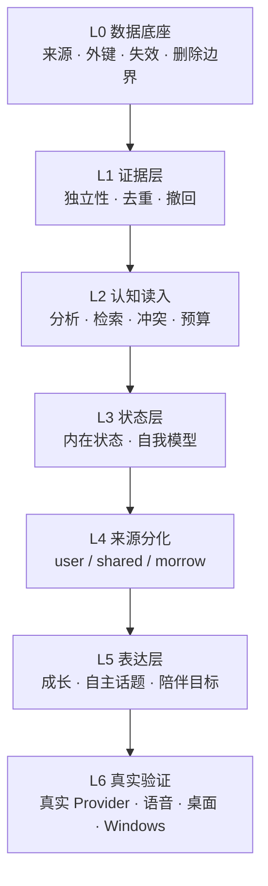

# Morrow V2 开发基准 v1.0（候选版）

> **状态：候选版，未经批准。**
> 本文件不是最终基准。按治理重置任务 §5 的要求，它必须由用户与独立审查确认后才能冻结为唯一开发基准。
> 依据：`43c92813763d9ca3b524d112c231af7f75843a5e` 的全仓审计（`docs/audit/morrow-v2-system-audit.md`）。

---

## 1. 产品目标与非目标

### 1.1 目标

Morrow 是一个**本地优先的长期 AI 伴侣**。判断一个改动是否属于本产品，只问一个问题：

> 它是否让 Morrow 在**跨会话、跨时间**的尺度上，更准确地记得、更一致地是「她自己」、更恰当地回应这个人？

### 1.2 非目标（永久）

| 不做 | 理由 |
|---|---|
| Agent / 工具自动执行 / 浏览器操控 / 桌面自动化 | 产品定位是伴侣，不是执行器。现有 `GoalService`（审批 + 工具）属 Agent 侧，**不进陪伴主链** |
| 回合外主动联系（推送、后台发起对话） | 没有回合就没有授权。现有提醒功能是用户显式安排的本地通知，且默认关闭 |
| 宣称意识、主观体验、真实情绪 | 所有「内在状态/兴趣/动机」都是**计算变量**，措辞必须保持此区分 |
| 云端存储用户数据 | 本地 SQLite 是唯一事实源；出网仅限用户逐次授权的 Provider 调用 |
| 多用户 / 账号体系 | 单机单用户 |

### 1.3 条件性不做

| 项 | 条件 |
|---|---|
| 语音 | 直到 L6 且具备真实音频设备与可复现评测方法 |
| 独立判断评分 | 直到有真实模型与人工/模型混合评分方案 |
| CI 作为验收证据 | 直到 GitHub Actions job 真正启动（当前 `steps=0`） |

---

## 2. 当前代码基线

| 项 | 值 |
|---|---|
| 分支 | `feat/stage-3-long-term-companion` |
| SHA | `43c92813763d9ca3b524d112c231af7f75843a5e` |
| PR | #19，base `feat/stage-2-delivery-hardening`，OPEN，未合并 |
| 迁移 | 33（`CURRENT_SCHEMA_VERSION=33`） |
| 测试 | 84 文件 / 756 用例 |
| 门槛 | `tsc` 0 / `vitest` 0 / `build` 0 |

### 2.1 架构边界（不可越过）

```
main（sandbox, contextIsolation）
  └─ src/app/index.ts        组合根，唯一装配点
       ├─ ChatService         一轮对话的唯一入口
       │    └─ ProviderPort   唯一出网点（openai-compatible.ts:269）
       ├─ 认知服务            memory / interest / self-model / reflection /
       │                      personalization / growth / exploration / goals / feeling
       └─ IPC（66 通道）      renderer 只能经 preload 的 contextBridge
renderer（vanilla TS，无框架，无 node 访问）
persistence（SQLite，WAL，foreign_keys ON，secure_delete ON）
```

**硬约束**

1. 认知服务不得直接 `fetch`；所有出网经 `dispatchToProvider`。
2. 认知数据不得存明文凭据；凭据只在 `secrets/*.bin`（safeStorage）。
3. 人格基线只能由用户编辑改变；任何模型/情绪/回合都不得写入。
4. 内在状态是计算变量，不得在 prompt 或 UI 里表述为主观体验。
5. 派生数据不得比它的来源活得久（删除/撤回必须传播）。

---

## 3. 分层（按真实依赖顺序，不按功能清单）



**禁止跳级规则**：任何 L*n* 的退出条件未全部满足，不得开始 L*n+1* 的功能开发。允许并行做 L*n+1* 的**设计**与**评测设计**，不得写实现。

---

## 4. 各层定义

### L0 数据底座

| 项 | 内容 |
|---|---|
| **目标** | 让每一份派生数据都能回答「你从哪来、来源没了你怎么办」 |
| **进入条件** | 无（当前即可开始） |
| **范围** | ① `memories.source_message_id`（缺失）；② `interest_evidence.interest_id` 外键；③ 删消息改为删**证据**而非删整条兴趣；④ `UNIQUE(evidence_ref)` 收窄为 `(interest_id, evidence_ref)`；⑤ `deletion_journal` 覆盖兴趣 / 自我模型 / 人格编辑 / 记忆归档；⑥ 补齐 `companion_goals.source_message_id` 外键与触发器 |
| **交付物** | 迁移 34（只增不改）；每条约束一个反向测试（删来源 → 派生必须消失或重算）；`docs/architecture/morrow-v2-data-lineage.md` 更新 |
| **退出条件** | ① 删一条消息后，仍被其它消息支持的兴趣**存活**且证据数正确；② 不存在任何指向已删行的 `interest_evidence`；③ 从备份恢复不会复活已撤回的兴趣/自我模型/人格编辑；④ 全部为自动化测试，非人工检查 |
| **失败回退** | 迁移 34 必须可在降级模式下打开（`DEGRADED_OPEN_MINIMUM_VERSION` 不变），失败保留 `.bak` |
| **禁止** | 不得顺手改任何 prompt、算法权重或 UI |

### L1 证据层

| 项 | 内容 |
|---|---|
| **目标** | 定义「一次独立证据」，并让计数不可被重试/修订/复制灌水 |
| **进入条件** | L0 退出 |
| **范围** | ① 独立证据单位：兴趣按**来源事件**、成长按**回合×维度**、反思按 `dedupe_key`（现状已如此，需写入契约）；② 兴趣强度的时间衰减（当前硬编码 0）；③ 缓存列与折叠值的一致性（当前 `interests.evidence_count` 是缓存，读时重算）；④ 崩溃在「提交后、钩子前」的证据丢失（P1-4） |
| **交付物** | 一份《证据契约》文档 + 每条规则的单元测试；一个「同一回合重试 3 次，证据数不变」的测试 |
| **退出条件** | ① 重试、修订、恢复各跑一次，证据计数不变；② 30 天不提及，兴趣强度按声明半衰期下降（可用注入时钟验证）；③ 提交后崩溃可通过启动期补偿恢复该回合证据，或明确记为丢失并留痕 |
| **禁止** | 不得为了让计数好看而引入「估算」或「补插」 |

### L2 认知读入

| 项 | 内容 |
|---|---|
| **目标** | 让「重要」真的影响「被想起」，让「冲突」真的被说出来 |
| **进入条件** | L1 退出 |
| **范围** | ① 记忆重要度进入检索排序（当前只决定归档）；② 巩固结果至少有一个消费者（或明确删除该能力）；③ 冲突分类（事实变化 / 偏好变化 / 时间变化 / 情境差异）；④ 检索预算与截断的可解释性（当前 `ContextMemory.score` 存的是准入分不是排序分） |
| **交付物** | 排序公式与参数版本号；一个「把重要度权重设为 0，召回顺序必须改变」的对照测试 |
| **退出条件** | ① 同一查询下，高重要度记忆的召回位次可被重要度改变（有对照）；② 冲突四类各有正例与反例；③ 检索结果可解释（每条能说出为何入选） |
| **禁止** | 不得用「加了字段」代替「改变了排序」 |

### L3 状态层

| 项 | 内容 |
|---|---|
| **目标** | 内在状态与自我模型都能被用户看见、纠正、确认 |
| **进入条件** | L2 退出 |
| **范围** | ① 自我模型的**确认**语义（当前只有 correct/retract，没有 confirm）；② 状态与自我模型的 UI（当前 IPC 齐全、renderer 零调用）；③ 状态对下游的影响范围要写清（当前只有检索宽度 +1~2 条 + 一行提示词） |
| **交付条件** | 界面可见、可操作；确认后的推断进入「已确认」集合且提示词措辞相应改变 |
| **退出条件** | ① 用户能确认一条推断，且下一轮措辞从「未经确认」变为「已确认」；② 用户能回滚人格漂移（当前 `rollback()` 无 IPC）；③ 状态变化能在 UI 上看到原因（哪个事件导致） |
| **禁止** | 不得把状态数值直接展示为「情绪」；必须保留「计算变量」措辞 |

### L4 来源分化（当前最大断点）

| 项 | 内容 |
|---|---|
| **目标** | 让「Morrow 自己的兴趣」有真实生产者 |
| **进入条件** | L3 退出 |
| **范围** | ① 反思产出的候选走 `observeMorrow()`（证据 `kind='reflection'`，引用 finding id）；② 反思候选需要**验证**（不能自动相信自己的生成文本）；③ `shared` 的升级规则（用户证据落在 Morrow 话题上 → shared，反向不成立） |
| **交付物** | 生产路径代码 + 一个「关掉反思，Morrow 兴趣必须消失」的消融 |
| **退出条件** | ① 正常使用 N 轮后，`SELECT origin,COUNT(*) FROM interests GROUP BY origin` 出现 `morrow`；② 该兴趣能进入提示词第 2 行；③ 关掉反思路径，该行消失（消融必须变红）；④ 该兴趣**不会**被误标为用户兴趣 |
| **失败回退** | 若反思质量不足，允许只产出 `candidate` 状态、永不晋升，但必须有明确阈值与拒绝理由留痕 |
| **禁止** | 不得用「用户说得多的主题」冒充 Morrow 的兴趣 |

### L5 表达层

| 项 | 内容 |
|---|---|
| **目标** | 让成长、自主话题、陪伴目标真正影响一轮回复 |
| **进入条件** | L4 退出 |
| **范围** | ① 人格成长的**读路径**必须有断言（当前零覆盖）；② 自主话题的资格集（依赖 L4）、预算释放（P0-6）、语义级提出检测（当前词面匹配）；③ 陪伴目标的生产写入路径（当前类型层就排除）；④ `describeGoals` 的 `\n` bug |
| **退出条件** | ① 删掉 `effectiveProfile` 调用，至少一个场景必须变红；② 拒绝授权两次后当日预算仍可用（预算不泄漏）；③ 陪伴目标可由用户经 UI 创建，并出现在下一轮 payload；④ 完成/过期的目标下一轮消失 |
| **禁止** | 不得用「评测直接调服务」代替「生产可写入」 |

### L6 真实验证

| 项 | 内容 |
|---|---|
| **目标** | 把「接线正确」升级为「模型真的这么做」 |
| **进入条件** | L5 退出，且 L0–L5 全部有「删功能必变红」的测试 |
| **范围** | ① 真实云 Provider（DeepSeek）n≥3，记录 model id、prompt hash、原始响应；② 真实本机模型（Ollama 或同级）；③ Electron 干净机 smoke；④ Windows 安装 + 升级 + 卸载保留数据；⑤ 真实时间跨度（≥7 天，每日真实交互）；⑥ 语音（若仍要做） |
| **退出条件** | 每项都有可复现命令、原始输出、环境指纹；失败项标 BLOCKED 且不计入通过率 |
| **禁止** | 不得把 scripted provider 说成真实模型；不得把注入时钟说成真实长期；不得把 `steps=0` 说成通过或失败 |

---

## 5. 统一验收语义

| 状态 | 含义 | 允许出现在交付报告里 |
|---|---|---|
| **PASS** | 断言在真实装配上执行且通过，且「删掉被测功能必须变红」已验证 | 是，计入分子 |
| **FAIL** | 断言执行且失败 | 是，必须修 |
| **BLOCKED** | 因外部条件无法执行（无凭据、无设备、平台未分配 runner） | 是，**不计入通过率** |
| **NOT_RUN** | 场景存在但本轮未执行（如依赖其它运行器） | 是，**不计入通过率** |
| **SKIPPED** | 前置条件不满足而主动跳过（如 S4 需要真实模型） | 是，**不计入通过率** |

**分母规则**：分母 = PASS + FAIL。BLOCKED / NOT_RUN / SKIPPED 单列，永不进分母。

---

## 6. 统一交付格式

### 6.1 固定文件路径

| 类型 | 路径 |
|---|---|
| 系统审计 | `docs/audit/morrow-v2-system-audit.md` |
| 运行时架构 | `docs/architecture/morrow-v2-runtime-architecture.md` |
| 认知闭环 | `docs/architecture/morrow-v2-cognitive-loop.md` |
| 数据血缘 | `docs/architecture/morrow-v2-data-lineage.md` |
| 成熟度矩阵 | `docs/audit/morrow-v2-capability-maturity-matrix.md` |
| 风险与依赖 | `docs/audit/morrow-v2-risk-dependency-register.md` |
| 开发基准 | `docs/governance/morrow-v2-development-baseline-v1.0-candidate.md` |
| 需求处置 | `docs/governance/issue-20-requirement-disposition.md` |
| 证据索引 | `docs/reports/morrow-v2-audit-evidence-index.md` |
| 交付报告 | `docs/reports/morrow-v2-audit-delivery-report.md` |
| 分层实现报告 | `docs/reports/morrow-v2-L<n>-delivery.md` |
| 算法登记 | `docs/algorithms/morrow-v2-algorithm-registry.md`（单一真相，禁止追加式「新版本」章节） |

### 6.2 每条交付必须包含

1. 分支名 + 基线 SHA + 最终 HEAD SHA（完整 40 位）。
2. 实际执行的命令、逐条退出码、测试文件数/用例数。
3. 每个能力的 M0–M6 级别，以及**升级所依据的那一条断言**。
4. BLOCKED / NOT_RUN / SKIPPED 清单及原因。
5. 结果文件路径（含 SHA 与时间戳），且结果文件里的 `codeCommit` 必须等于实际生成提交。
6. 「删掉该功能，哪条断言会变红」的对照说明。

### 6.3 禁止

- 用文档代替实现。
- 用「测试数量」「CI 绿灯」「prompt 里出现某字符串」作为能力证据。
- 结果文件的 `codeCommit` 用环境变量覆盖成非实际值（当前 `MORROW_EVAL_SHA` 可任意覆盖，属已知风险）。

---

## 7. 角色分离

| 角色 | 职责 | 禁止 |
|---|---|---|
| **开发 Agent** | 实现、写测试、跑门槛、如实报告 | 自评「已掌握」；修改评测断言使其通过；把 BLOCKED 写成 PASS |
| **独立审计 Agent** | 只读复核：代码、调用链、payload、评测有效性、文档一致性 | 改业务代码；替开发 Agent 修测试；接受「模块存在」作为证据 |

**交接规则**：开发 Agent 交付后，独立审计 Agent 必须独立复核并给出 GO/NO-GO；两者结论不一致时，以审计 Agent 为准，并记录分歧点。

**本文件的作者是开发侧 Agent，因此它不能自我批准。** 必须由独立审查确认。

---

## 8. 真实环境验证门槛（独立于功能层）

| 环境 | 最低证据 | 当前状态 |
|---|---|---|
| 云 Provider | 真实 model id + n≥3 + 原始响应 + prompt hash + 授权为真人点击（非 harness 自动同意） | 仅 Spark n=1，`production_equivalent:false` |
| 本机 Provider | 真实模型（Ollama 等）+ 真实生成（非硬编码响应） | 仅假 SSE 服务 |
| Electron renderer | 干净机 `npm run smoke` 通过，且非 `--no-sandbox` | 本机崩溃 `0x80000003` |
| Windows 安装 | 安装 → 启动 → 升级（旧版本数据保留）→ 卸载（数据保留）→ 重装 | 无产物 |
| 真实时间 | ≥7 天，每日真实交互，记录 DB 增长与事件日志增长 | 最长 71 秒 |
| 语音 | 真实设备 + 真实 ASR/TTS | 无代码 |

---

## 9. 下一轮的任务边界（建议）

**只做 L0 + L1**，不做任何 L4/L5 的新功能。

理由：当前 7 项 P0 里有 5 项是「上层建在没有来源的底座上」。L0/L1 完成后，L4 才有意义；L4 完成后，L5 才有输入。反过来做，只会继续增加「有代码、无输入」的模块。

**建议的 L0 第一批（可独立验收）**：

1. 迁移 34：`memories.source_message_id`、`interest_evidence` 外键、`UNIQUE` 收窄、`deletion_journal` 扩展。
2. 触发器修正：删消息 → 删证据 + 重算兴趣，而不是删整条兴趣。
3. 反向测试：删来源 → 派生消失或重算；删一条 → 其它证据仍支撑。
4. 恢复边界测试：旧备份不得复活已撤回的兴趣/自我模型/人格编辑。

这一批不改任何 prompt、不改任何算法权重、不改 UI，风险最低，且直接消除 P0-4。

---

## 10. 批准状态

| 项 | 状态 |
|---|---|
| 本文件 | **候选版（CANDIDATE）** |
| 是否可据此开始开发 | 可以据此**设计**，实现需用户确认后 |
| 是否需要独立审查 | **是，必须** |
| 冻结为唯一基准的条件 | 用户确认 + 独立审查 GO + 本文件第 4 节的进入/退出条件被接受 |

---

*本文件不宣布任何能力已完成。它只声明：在当前代码事实上，正确的下一步是什么。*
